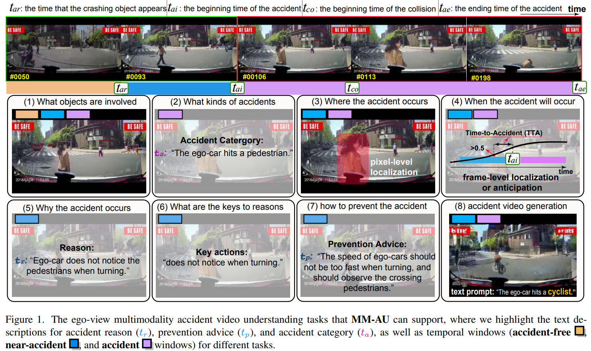

# LOTVS-MM-AU



## 1. Introduction

<!-- [ALGORITHM] -->

```BibTeX
@InProceedings{Fang_2024_CVPR,
    author    = {Fang, Jianwu and Li, Lei-lei and Zhou, Junfei and Xiao, Junbin and Yu, Hongkai and Lv, Chen and Xue, Jianru and Chua, Tat-Seng},
    title     = {Abductive Ego-View Accident Video Understanding for Safe Driving Perception},
    booktitle = {Proceedings of the IEEE/CVF Conference on Computer Vision and Pattern Recognition (CVPR)},
    month     = {June},
    year      = {2024},
    pages     = {22030-22040}
}
```

## 2. To install the environment, run the following script:
```shell
bash scripts/install.sh
```

## 3. To download the dataset, run the following script:
```shell
bash scripts/download_dataset.sh
```

## 4. To train and test the model for the MM-AU dataset, run the following script:
```shell
bash scripts/train.sh
```

## 5. Acknowledgement
* [jeffreychou777/LOTVS-MM-AU](https://github.com/jeffreychou777/LOTVS-MM-AU)
