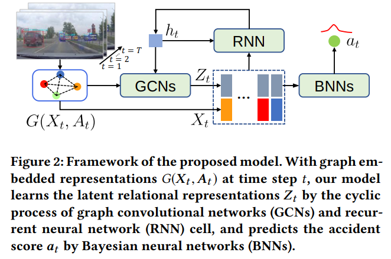

# UString



## 1. Introduction

<!-- [ALGORITHM] -->

```BibTeX
@inproceedings{bao2020uncertainty,
  title={Uncertainty-based traffic accident anticipation with spatio-temporal relational learning},
  author={Bao, Wentao and Yu, Qi and Kong, Yu},
  booktitle={Proceedings of the 28th ACM International Conference on Multimedia},
  pages={2682--2690},
  year={2020}
}
```

## 2. To train, test and demo the model for the CCD dataset, run the following scripts:
```shell
bash scripts/train_crash.sh
bash scripts/test_crash.sh
bash scripts/demo_crash.sh
```

## 3. To train, test and demo the model for the DAD dataset, run the following scripts:
```shell
bash scripts/train_dad.sh
bash scripts/test_dad.sh
bash scripts/demo_dad.sh
```

## 4. Acknowledgement
* [Cogito2012/UString](https://github.com/Cogito2012/UString)
