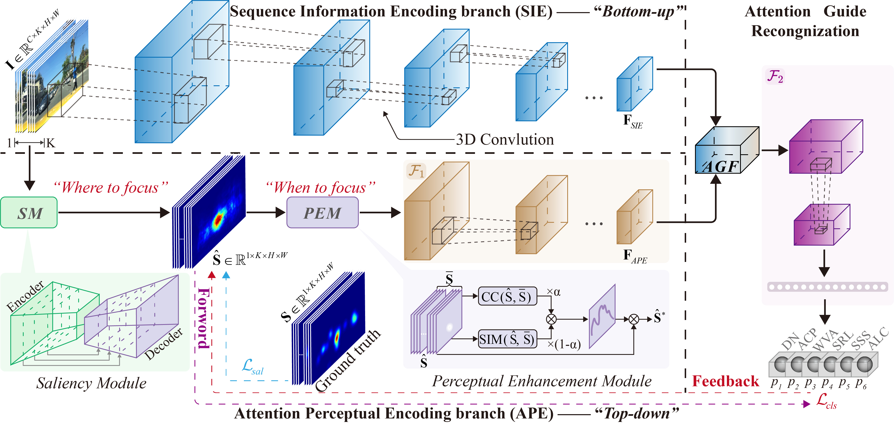

# VP2Net



## 1. Introduction

<!-- [ALGORITHM] -->

```BibTeX
@ARTICLE{zhao2025vp2net,
  author={Zhao, Chunyu and Deng, Tao and Du, Pengcheng and Liu, Wenbo and Huang, Yi and Yan, Fei},
  journal={IEEE Transactions on Intelligent Transportation Systems}, 
  title={VP2Net: Visual Perception-Inspired Network for Exploring the Causes of Drivers’ Attention Shift}, 
  year={2025},
  volume={26},
  number={11},
  pages={20012-20026},
  doi={10.1109/TITS.2025.3610121}
}
```

## 2. To processs the dataset, run the following scripts:
```shell
bash scripts/process_dataset.sh
```

## 3. To train and test the model, run the following scripts:
```shell
bash scripts/train.sh
bash scripts/test.sh
```

## 4. Acknowledgement
* [zhao-chunyu/VP2Net](https://github.com/zhao-chunyu/VP2Net)
