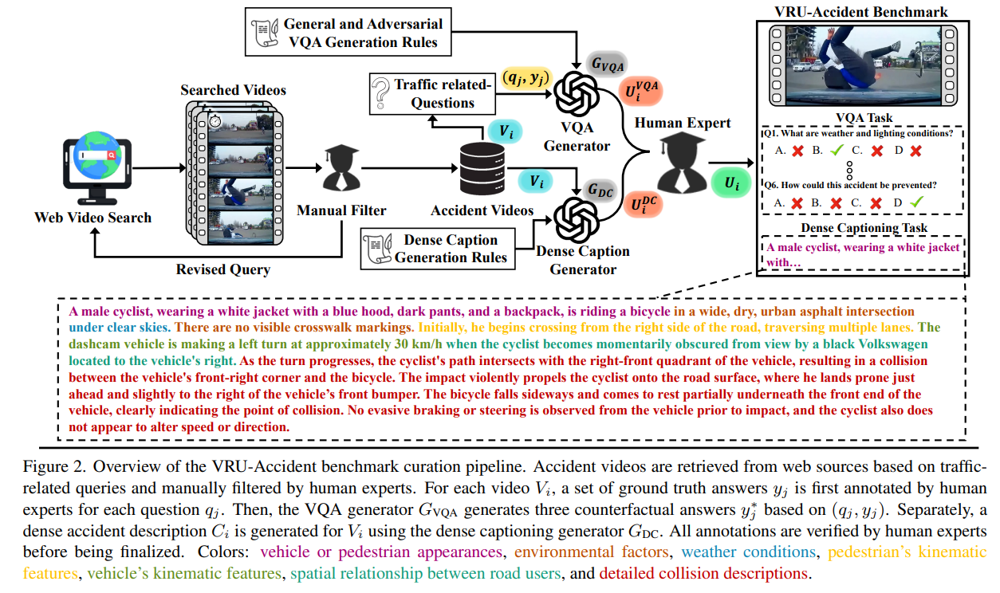

# VRU-Accident



## 1. Introduction

<!-- [ALGORITHM] -->

```BibTeX
@InProceedings{Kim_2025_ICCV,
    author    = {Kim, Younggun and Abdelrahman, Ahmed S. and Abdel-Aty, Mohamed},
    title     = {VRU-Accident: A Vision-Language Benchmark for Video Question Answering and Dense Captioning for Accident Scene Understanding},
    booktitle = {Proceedings of the IEEE/CVF International Conference on Computer Vision (ICCV) Workshops},
    month     = {October},
    year      = {2025},
    pages     = {761-771}
}
```

## 2. To install the environment run the following script:
```shell
bash scripts/install.sh
```

## 3. To download the dataset, run the following script:
```shell
bash scripts/download_dataset.sh
```

## 4. To download pretrained weights, run the following script:
```shell
bash scripts/download_weights.sh
```

## 5. To train and test the model for the VRU dataset, run the following scripts:
```shell
bash scripts/train.sh
bash scripts/test.sh
```

## 6. Acknowledgement
* [Kimyounggun99/VRU-Accident](https://github.com/Kimyounggun99/VRU-Accident)
