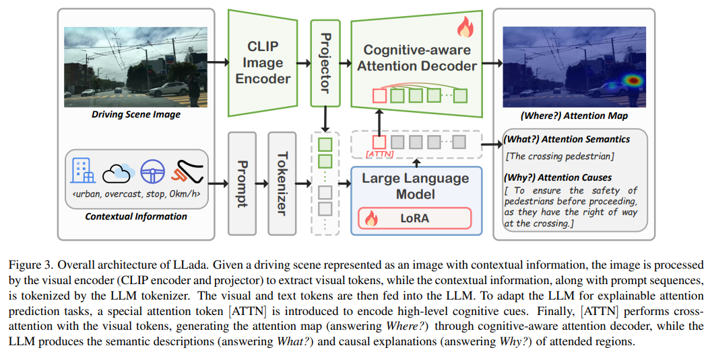

# W3DA



## 1. Introduction

<!-- [ALGORITHM] -->

```BibTeX
@inproceedings{zhou2025where,
      title={Where, What, Why: Towards Explainable Driver Attention Prediction}, 
      author={Yuchen Zhou and Jiayu Tang and Xiaoyan Xiao and Yueyao Lin and Linkai Liu and Zipeng Guo and Hao Fei and Xiaobo Xia and Chao Gou},
      year={2025},
      eprint={2506.23088},
      archivePrefix={arXiv},
      primaryClass={cs.CV},
      url={https://arxiv.org/abs/2506.23088}, 
}
```

## 2. To install the environment, run the following script:
```shell
bash scripts/install.sh
```

## 3. To download the dataset, run the following script:
```shell
bash scripts/download_dataset.sh
```

## 4. To download pretrained weights, run the following script:
```shell
bash scripts/download_weights.sh
```

## 5. To train and test the model for the W3DA dataset, run the following scripts:
```shell
bash scripts/train.sh
bash scripts/test.sh
```

## 6. Acknowledgement
* [yuchen2199/Explainable-Driver-Attention-Prediction](https://github.com/yuchen2199/Explainable-Driver-Attention-Prediction)
